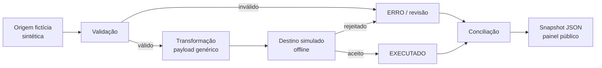

# Migrador Folha Demo

**Da origem legada ao destino simulado, cada registro tem uma trilha verificável.**

[](https://leandroavalle.github.io/migrador-folha-demo/)
[](https://github.com/LeandroAValle/migrador-folha-demo/actions/workflows/showcase.yml)

> **Sobre a apresentação visual:** o aplicativo profissional é desktop e não há uma tela pública de demonstração disponível. Esta página usa o logotipo presente nos recursos locais; não inventa telas nem expõe dados reais. O simulador técnico deste repositório é uma implementação independente de portfólio, com dados fictícios.

> Implementação pública e independente. Não contém código, dados, configurações ou credenciais do migrador privado. O destino é um **simulador offline**, sem integração com a API real da Betha.

## Finalidade

O Migrador de Folha apoia equipes de folha, implantação e dados na transferência de registros entre sistemas legados e um sistema de destino. O processo valida e transforma cada registro, acompanha a resposta do destino e reconcilia os resultados.

**Problema que resolve:** torna visíveis registros inválidos, rejeitados ou ainda não conciliados, para que a equipe possa corrigir e conferir a migração. O simulador deste repositório usa dados fictícios e não se conecta à Betha.

## Em 30 segundos

O projeto executa uma migração de folha totalmente fictícia em Python: gera registros de origem, valida campos, transforma payloads genéricos, recebe respostas simuladas por registro e reconcilia o resultado. A página publicada apresenta o estudo de caso; o simulador pode ser executado localmente.

**Demonstra:** desenho de pipeline, validação antes do envio, identidade estável, processamento em lotes conceituais, tratamento explícito de erro, reconciliação, testes e documentação.

## Explore

| Recurso | Link |
| --- | --- |
| Estudo de caso | [Abrir página](https://leandroavalle.github.io/migrador-folha-demo/) |
| Simulador offline | [Executar localmente](#execute-localmente) |
| Arquitetura | [Fluxo e limites](docs/ARCHITECTURE.md) |
| Decisões | [Motivos e consequências](docs/DECISIONS.md) |
| Dados | [Dicionário e métricas](docs/DATA.md) |
| Segurança | [Privacidade e escopo](docs/SECURITY.md) |

## Arquitetura



| Camada | Tecnologia | Responsabilidade |
| --- | --- | --- |
| Pipeline | Python 3.10+ / biblioteca padrão | Geração, validação, transformação, simulação e reconciliação |
| Testes | `unittest` | Determinismo, bloqueio de inválidos e preservação de chave |
| Interface | HTML, CSS e JavaScript | Exploração do snapshot estático |
| Entrega | GitHub Actions e Pages | Testes, consistência do snapshot e publicação |

## Execute localmente

Não há dependências externas nem credenciais.

```bash
python -m unittest discover -s tests -v
python -m payroll_demo build
python -m http.server 8000 --directory site
```

Abra `http://localhost:8000`. O segundo comando grava `site/data/snapshot.json` com o mesmo resultado em toda execução.

## Regras de negócio demonstradas

1. **Validar antes de preparar envio:** um código obrigatório ausente bloqueia o registro; nenhum payload é criado para ele.
2. **Preservar chave estável:** `sourceKey` da origem vira `externalKey` no payload ilustrativo, permitindo rastrear o registro.
3. **Não presumir sucesso:** a resposta do destino simulado é registrada como `EXECUTADO` ou `ERRO`; rejeição fica pendente de revisão.
4. **Conciliar totais:** `extraídos = executados + para revisão`, tanto no total quanto por entidade.
5. **Reprodução:** uma semente fixa produz o mesmo snapshot e permite verificar diferenças em revisão de código.

Os tipos e nomes de payload são **ilustrativos**; não descrevem o contrato real de um fornecedor. Veja [decisões técnicas](docs/DECISIONS.md).

## Relação com a experiência profissional

O tema vem da experiência com migração de folha de pagamento e bases legadas. O repositório profissional original integra SQL Server e uma API de destino, contém configurações sensíveis e permanece privado. Este demo foi escrito separadamente para explicar o raciocínio técnico sem publicar recursos operacionais.

## Autor

**Leandro Valle** — desenvolvimento full stack, migração, integrações e engenharia de dados. [Perfil GitHub](https://github.com/LeandroAValle).
